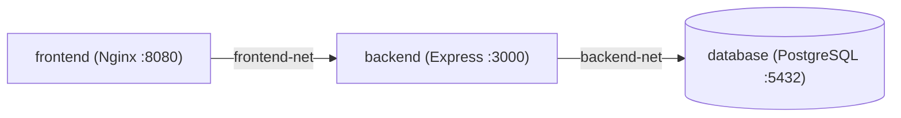

# Multi-Container Orchestration Reference (`docker-compose.yml`)

This document explains the architecture, networking, security hardening, and validation tools used for [`docker-compose.yml`](file:///home/leo/leo/daily-practice-lab/opsticket-practice/ops-ticket-devops-lab/docker-compose.yml).

---

## 1. Production-Grade `docker-compose.yml` Reference

```yaml
name: opsticket

services:
  backend:
    build:
      context: ./backend
    depends_on:
      database:
        condition: service_healthy
    environment:
      DB_HOST: database
      DB_NAME: ${DB_NAME:-opsticket}
      DB_PASSWORD: ${DB_PASSWORD}
      DB_PORT: 5432
      DB_USER: ${DB_USER:-postgres}
      FRONTEND_URL: ${FRONTEND_URL:-http://localhost}
      JWT_SECRET: ${JWT_SECRET}
      PORT: ${PORT:-3000}
    networks:
      - backend-net
      - frontend-net
    restart: unless-stopped
    healthcheck:
      test: [ "CMD-SHELL", "wget --no-verbose --tries=1 --spider http://localhost:${PORT:-3000}/health || exit 1" ]
      interval: 10s
      timeout: 5s
      retries: 5
      start_period: 10s
    security_opt:
      - no-new-privileges:true

  database:
    image: postgres:16-alpine
    volumes:
      - postgres_data:/var/lib/postgresql/data
    environment:
      POSTGRES_DB: ${DB_NAME:-opsticket}
      POSTGRES_PASSWORD: ${DB_PASSWORD}
      POSTGRES_USER: ${DB_USER:-postgres}
    networks:
      - backend-net
    restart: unless-stopped
    healthcheck:
      test: [ "CMD-SHELL", "pg_isready -U ${DB_USER:-postgres} -d ${DB_NAME:-opsticket}" ]
      interval: 10s
      timeout: 5s
      retries: 5
      start_period: 10s
    security_opt:
      - no-new-privileges:true

  frontend:
    build:
      context: ./frontend
    depends_on:
      backend:
        condition: service_healthy
    ports:
      - '127.0.0.1:${FRONTEND_PORT:-80}:8080'
    networks:
      - frontend-net
    restart: unless-stopped
    security_opt:
      - no-new-privileges:true

networks:
  backend-net:
    driver: bridge
  frontend-net:
    driver: bridge

volumes:
  postgres_data:
```

---

## 2. Key Architectural Decisions Explained

### A. `name: opsticket` Instead of Deprecated `version: '3.8'`
* In modern Docker Compose V2 (Compose Specification), the `version:` key is officially deprecated.
* Adding `name: opsticket` at line 1 locks the project namespace so images (`opsticket-backend`, `opsticket-frontend`), networks (`opsticket_backend-net`), and volumes (`opsticket_postgres_data`) are named consistently even if a developer renames the git repository folder.

### B. Two-Tier Network Isolation (`frontend-net` vs. `backend-net`)

* **Without custom networks:** Docker places all 3 containers on a single shared bridge network (`default`), allowing the `frontend` container to reach `database:5432` directly.
* **With `frontend-net` and `backend-net`:**
  * `frontend` only belongs to `frontend-net`.
  * `database` only belongs to `backend-net`.
  * `backend` bridges both networks.
  * **Result:** `frontend` cannot ping or connect to `database`—mirroring public vs. private subnets in AWS VPC!

### C. Single Entry Point (API Gateway) & Loopback Interface Binding (`127.0.0.1:`)
* **Why `database` and `backend` do NOT expose `ports:`:**
  Because [`frontend/nginx.conf`](file:///home/leo/leo/daily-practice-lab/opsticket-practice/ops-ticket-devops-lab/frontend/nginx.conf) proxies `/api/` requests internally to `http://backend:3000`, `frontend` acts as the **Single Entry Point (Reverse Proxy / API Gateway)** on port `80`. Neither `backend` (`3000`) nor `database` (`5432`) needs a host port mapped unless you are connecting a desktop tool like DBeaver/pgAdmin.
* **Why `127.0.0.1:` is used on exposed ports:**
  Writing `"80:8080"` binds the port to `0.0.0.0` (all network interfaces) and modifies Linux `iptables` directly—bypassing `ufw` and exposing local containers to anyone on the same Wi-Fi/LAN. Prefixing port mappings with `127.0.0.1:` ensures only your local machine can reach the port (`dclint` rule `no-unbound-port-interfaces`).

### D. Variable Fallbacks (`${VAR:-default}`) vs. Required Secrets (`${VAR:?error}`)
* **`${VAR:-default}` (Local Dev & Interview Demos):**
  Provides a fallback default so any developer or interviewer can clone the repo and run `docker compose up` immediately without creating a `.env` file.
* **`${VAR:?error}` (Production Compose Secret Enforcement):**
  > [!WARNING]
  > Writing plain `${DB_PASSWORD}` (without `:?`) does **NOT** stop Docker Compose if the variable is missing—it silently passes an empty string `""`!
  > To force Docker Compose to abort startup when a production secret is missing, use `${DB_PASSWORD:?DB_PASSWORD must be set in .env}` and `${JWT_SECRET:?JWT_SECRET must be set in .env}`.

### E. Scaling Replicas (`container_name:`) & How Kubernetes Handles Image Versioning (`image:` Tags)

There are two critical naming and versioning concepts in Docker, Docker Compose, and Kubernetes that often get confused:

#### 1. Why Hardcoding `container_name:` Breaks Scaling Replicas
* **`image:` is the Blueprint; `container_name:` is the Running Instance:**
  100 running containers can all run from the exact same `image:`. However, Docker requires every running container on a host to have a **unique `container_name`**.
* **What breaks if you add `container_name: opsticket-backend`:**
  If you try to scale the backend to 3 replicas (`docker compose up --scale backend=3`), the 2nd replica immediately fails with:
  ```text
  Error response from daemon: Conflict. The container name "/opsticket-backend" is already in use
  ```
* **The Fix:** Never hardcode `container_name:` on scalable services. When omitted, Docker Compose automatically appends the replica number (`opsticket-backend-1`, `opsticket-backend-2`, `opsticket-backend-3`), just like Kubernetes appends a unique Pod hash (`opsticket-backend-7d9c8b-x9z2p`).

#### 2. Why Hardcoding `:latest` on `image:` Breaks Kubernetes & Rollbacks
In production orchestrators (Kubernetes, AWS ECS, or production Compose deployments), using a static/mutable tag like `image: opsticket-backend:latest` causes two major production failures:
1. **The Kubernetes Node Cache Trap (`imagePullPolicy: IfNotPresent`):**
   If a Kubernetes worker node already has `opsticket-backend:latest` cached on disk, and you push a bugfix that overwrites `:latest` in ECR/Docker Hub, Kubernetes looks at the deployment YAML, sees the tag string hasn't changed (`:latest == :latest`), and **does not pull your new code**—leaving new Pods running the old cached image!
2. **Impossible Rollbacks at 2 AM:**
   When every CI/CD build overwrites `:latest` in the container registry, the previous working image loses its tag. If a new deployment crashes in production, you cannot easily roll back to the previous version because `:latest` was overwritten.

#### 3. How Production CI/CD & Kubernetes Handle Image Versioning
* **Local Dev (`docker-compose.yml`):**
  Uses `build:` (with `name: opsticket` at line 1) to build directly from local source code. (`dclint` enforces rule `no-build-and-image` so local `build:` and remote `image:` are not mixed in the same dev file.)
* **Production / CI-CD / Kubernetes:**
  Never builds from source on the server. Instead, CI/CD builds the image once, tags it with an **immutable version**—either the **Git Commit SHA** (`opsticket-backend:a1b2c3d`) or **Semantic Version** (`opsticket-backend:v1.2.0`)—pushes it to ECR/Docker Hub, and injects it via an environment variable:
  ```yaml
  # In a production deployment or Kubernetes manifest:
  image: 123456789012.dkr.ecr.us-east-1.amazonaws.com/opsticket-backend:${IMAGE_TAG}
  ```
  Because every commit has a unique `${IMAGE_TAG}` (e.g., `a1b2c3d` → `f4e5d6c`), Kubernetes immediately detects the tag change, pulls the exact new image on every node, and can roll back to `a1b2c3d` in seconds if anything goes wrong!

---

## 3. How to Validate & Lint `docker-compose.yml`

### 1. Built-in Syntax & Variable Validator (`docker compose config`)
```bash
# Quiet validation (exits 0 if valid)
docker compose config -q && echo "✅ Valid Docker Compose syntax!"

# Print rendered YAML with all ${VAR:-default} values interpolated
docker compose config
```

### 2. Docker Compose Linter (`dclint`)
```bash
# Check for errors, unbound ports, and canonical key ordering
docker run --rm -t -v "$(pwd):/app" zavoloklom/dclint /app/docker-compose.yml

# Auto-fix formatting and key ordering warnings
docker run --rm -v "$(pwd):/app" zavoloklom/dclint --fix /app/docker-compose.yml
```

### 3. Trivy IaC Config Scanner (`trivy config`)
> [!NOTE]
> `trivy config` scans `Dockerfile`, Terraform (`.tf`), and Kubernetes manifests—not `docker-compose.yml`. Always point `trivy config` at the repository folder (`/workspace`) so it discovers all `Dockerfile`s automatically:
```bash
docker run --rm -v "$(pwd):/workspace" aquasec/trivy config /workspace
```
