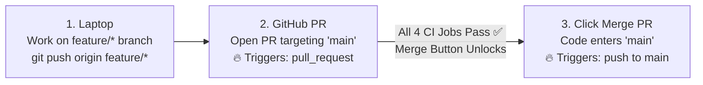

# 01 — GitHub Actions CI Pipeline & Branch Protection Guide (Complete 4-Job Reference)

This document explains **what** every instruction in [`.github/workflows/ci.yml`](../../.github/workflows/ci.yml) does, **why** we chose these 4 jobs (`frontend`, `backend`, `docker`, `terraform`), **how** to explain the architecture in interviews, and **what breaks** if any piece is removed or misconfigured.

---

## 1. The Big Picture: Why These 4 Jobs? (Plain-English & Interview Guide)

**Continuous Integration (CI)** has one primary goal:
> *"Verify that new code is working, properly packaged, and safe **BEFORE** allowing it to merge into `main`."*

Think of CI like an **airport security and luggage inspection line** before a plane takes off. Developers write the application code, while **DevOps** builds the automated quality and security gates so broken or vulnerable code never reaches production.

### The "Fail Fast" Principle (Fastest/Cheapest Checks First)

| Stage / Job | Plain-English Question | What Runs | Why It Matters for DevOps |
| :--- | :--- | :--- | :--- |
| **1. App Tests** (`frontend` & `backend`) | *"Does the product even work?"* | `npm ci`, `npm test`, `npm run build` (+ live Postgres 16 container) | If a developer broke a login route or database query, stop immediately before wasting time building containers. |
| **2. Dockerfile Lint** (`docker` — Step 2) | *"Is the container blueprint written properly?"* | `hadolint` on `backend/Dockerfile` & `frontend/Dockerfile` | **Grammarly for Dockerfiles.** Takes 2 seconds to catch bad practices (`root` user, unpinned tags) before building. |
| **3. Container Build** (`docker` — Step 3) | *"Does the app actually package into the box?"* | `docker build` for `backend` and `frontend` | Proves the production multi-stage containers build cleanly and prepares the built images for Trivy. |
| **4. Container Scan** (`docker` — Step 4) | *"X-Ray the box for hidden weapons or leaked secrets"* | `trivy image` (`--severity CRITICAL --exit-code 1`) | Scans OS packages (`apk`), app packages (`npm`), **and hardcoded secrets** inside the built images. |
| **5. IaC Validation** (`terraform` job) | *"Does our cloud blueprint have typos or security holes?"* | `terraform fmt -check`, `init -backend=false`, `validate`, `trivy config` | Checks Terraform syntax and AWS security rules **without** needing AWS credentials or spending money. |

*(Note: Pushing images to AWS ECR and running `terraform apply` belongs to **CD (`deploy.yml`)**, which runs only after code is merged into `main`).*

### 🎙️ Your 30-Second Interview Script
> *"I designed our CI pipeline in GitHub Actions around the **'Fail Fast'** principle so we catch issues before code ever touches `main`.*
>
> *First, we run parallel **unit and integration tests** for the frontend and backend—using a live PostgreSQL service container—to verify the application logic works.*
>
> *Second, on the DevOps and DevSecOps side, we lint our Dockerfiles with **Hadolint** in seconds to enforce container best practices before spending runner time building images. Then we run a **Docker build** to verify our multi-stage production containers package cleanly, and scan those built images with **Trivy** for both Critical CVEs and leaked secrets.*
>
> *Finally, a **Terraform validation job** runs `fmt`, `validate` with `-backend=false`, and `trivy config` so no broken or insecure cloud code can be merged."*

---

## 2. Git Workflow, PR Targeting, Branch Protection & Git Gotchas



### Key Concepts for Quick Recall

* **`git push` vs. Pull Request (PR):**
  * Running `git push` from your laptop only uploads your local branch (e.g., `feature/day2-ci-pipeline`) to the exact same branch name on GitHub.
  * Whenever you want to **merge one branch into another branch** (`feature/day2-ci-pipeline` $\rightarrow$ `main`), you open a **Pull Request (PR)** on GitHub.
* **What if a CI check fails on an open PR?**
  * You do **not** create a new branch or a new PR. You stay on the **exact same feature branch**, fix the issue locally, run `git commit` and `git push`, and GitHub automatically updates the open PR and re-runs CI.
* **Why Uncommitted Changes "Float" Across Branches (VS Code Restart Gotcha):**
  * Saving a file in VS Code (`Ctrl+S`) only writes to your **hard drive (Working Directory)**—it does **not** lock the change to your Git branch until you run **`git add`** and **`git commit`**.
  * Uncommitted edits "float" with you if you switch branches (`main` $\leftrightarrow$ `feature/*`). Meanwhile, any branch you created (`git checkout -b ...`) is safely persisted inside `.git/` on disk even if VS Code crashes.
* **Required Status Checks (Locking the Merge Button) & The "CI-Gate" Pattern:**
  * Checking *"Require a pull request before merging"* alone still allows clicking Merge even if CI fails (red ❌).
  * You must check **☑ Require status checks to pass before merging** (and add `frontend`, `backend`, `docker`, `terraform`) + **☑ Require branches to be up to date before merging**.
  * **Enterprise "CI-Gate" Pattern:** In large companies with 20+ CI jobs, instead of manually adding 20 job names in GitHub Settings, engineers add one tiny summary job at the bottom of `ci.yml` (`ci-gate:` with `needs: [frontend, backend, docker, terraform, ...]`) and require only `ci-gate` in Branch Protection.

---

## 3. Complete `.github/workflows/ci.yml` (All 4 Jobs)

```yaml
name: CI Pipeline

# Concept 1: The Trigger (When does this run?)
on:
  push:
    branches: ["main"]
  pull_request:
    branches: ["main"]

jobs:
  # Job 1: Frontend Unit Tests & Build
  frontend:
    runs-on: ubuntu-latest
    defaults:
      run:
        working-directory: ./frontend

    steps:
      - name: Checkout repository
        uses: actions/checkout@v4

      - name: Setup Node.js 22
        uses: actions/setup-node@v4
        with:
          node-version: 22
          cache: "npm"
          cache-dependency-path: frontend/package-lock.json

      - name: Install dependencies
        run: npm ci

      - name: Run unit tests
        run: npm test

      - name: Build production bundle
        run: npm run build

  # Job 2: Backend Integration Tests with Live PostgreSQL Service Container
  backend:
    runs-on: ubuntu-latest
    defaults:
      run:
        working-directory: ./backend

    services:
      postgres:
        image: postgres:16-alpine
        env:
          POSTGRES_USER: postgres
          POSTGRES_PASSWORD: postgres
          POSTGRES_DB: opsticket_test
        ports:
          - 5432:5432
        options: >-
          --health-cmd pg_isready
          --health-interval 10s
          --health-timeout 5s
          --health-retries 5

    steps:
      - name: Checkout repository
        uses: actions/checkout@v4

      - name: Setup Node.js 22
        uses: actions/setup-node@v4
        with:
          node-version: 22
          cache: "npm"
          cache-dependency-path: backend/package-lock.json

      - name: Install dependencies
        run: npm ci

      - name: Run database tests
        env:
          NODE_ENV: test
          DB_HOST: localhost
          DB_PORT: 5432
          DB_USER: postgres
          DB_PASSWORD: postgres
          DB_NAME_TEST: opsticket_test
          JWT_SECRET: super-secret-test-jwt-key
          FRONTEND_URL: http://localhost:5173
        run: npm test

  # Job 3: Container Linting (Hadolint), Building & Security Scanning (Trivy)
  docker:
    runs-on: ubuntu-latest

    steps:
      - name: Checkout repository
        uses: actions/checkout@v4

      - name: Lint Backend Docker
        run: docker run --rm -i hadolint/hadolint < ./backend/Dockerfile

      - name: Lint Frontend Dockerfile
        run: docker run --rm -i hadolint/hadolint < ./frontend/Dockerfile

      - name: Build Backend Docker Image
        run: docker build -t opsticket-backend:ci ./backend

      - name: Build Frontend Docker Image
        run: docker build -t opsticket-frontend:ci ./frontend

      - name: Trivy Scan Backend Image
        run: |
          docker run --rm \
            -v /var/run/docker.sock:/var/run/docker.sock \
            -v $(pwd)/.trivyignore:/.trivyignore \
            aquasec/trivy:latest image \
            --table-mode detailed \
            --ignorefile /.trivyignore \
            --severity CRITICAL \
            --exit-code 1 \
            opsticket-backend:ci

      - name: Trivy Scan Frontend Image
        run: |
          docker run --rm \
            -v /var/run/docker.sock:/var/run/docker.sock \
            -v $(pwd)/.trivyignore:/.trivyignore \
            aquasec/trivy:latest image \
            --table-mode detailed \
            --ignorefile /.trivyignore \
            --severity CRITICAL \
            --exit-code 1 \
            opsticket-frontend:ci

  # Job 4: Terraform Formatting, Syntax Validation & IaC Security Scan
  terraform:
    runs-on: ubuntu-latest
    defaults:
      run:
        working-directory: ./terraform

    steps:
      - name: Checkout repository
        uses: actions/checkout@v4

      - name: Setup Terraform
        uses: hashicorp/setup-terraform@v3

      - name: Check Terraform Formatting
        run: terraform fmt -check

      - name: Initialize Terraform (No AWS Backend Needed)
        run: terraform init -backend=false

      - name: Validate Terraform Configuration
        run: terraform validate

      - name: Trivy IAC Config Scan
        run: |
          docker run --rm \
            -v $(pwd):/terraform \
            aquasec/trivy:latest config \
            --severity CRITICAL \
            --exit-code 1 \
            /terraform
```

---

## 4. Job-by-Job Deep Dive

### Job 1 & Job 2 — `frontend` and `backend`
* **Why each job gets `runs-on: ubuntu-latest`:** Every job under `jobs:` spins up its own independent, fresh Ubuntu virtual machine and runs **in parallel** with the other jobs.
* **`defaults.run.working-directory` Gotcha:** Only applies to `run:` shell commands—it does **not** apply to `uses:` plugins (`actions/setup-node@v4`), which always execute from the repository root.
* **Why `backend` uses `services: postgres:`:** Backend tests run real SQL migrations and queries (`knex` + `pg`). GitHub Actions spins up a temporary `postgres:16-alpine` container alongside the runner and waits for `--health-cmd pg_isready` before running `npm test`.

---

### Job 3 — `docker` (Hadolint $\rightarrow$ Docker Build $\rightarrow$ Trivy)
* **Why all 3 steps must live inside ONE `docker` job:**
  * Each job in `ci.yml` runs on a separate Ubuntu machine that is wiped when the job finishes.
  * If `docker build` ran in Job A and `trivy image` ran in Job B, Job B's machine would not have the built Docker image!
* **Why we don't write new Dockerfiles or use `docker-compose.yml` in CI:**
  * We point `docker build` directly at our existing `./backend` and `./frontend` folders from Day 1.
  * Trivy (`trivy image`) scans the **built image ("packed suitcase")** directly—the container does **not** need to be running (`docker compose up`), and we avoid needing a `.env` file or live database just to scan the image layers.
* **Key Trivy CI Flags:**
  * **Built-in Secret Scanning:** By default, Trivy scans for both **CVEs (`vuln`)** and **hardcoded secrets (`secret`)** (API keys, `.env` files, private keys).
  * **`--table-mode detailed`:** Hides the 850+ lines of clean (`0` vulnerability) packages so CI logs only display actual failing CVEs.
  * **`--ignorefile /.trivyignore`:** Mounts our root [`.trivyignore`](../../.trivyignore) file into the Trivy container to ignore documented false positives (such as `CVE-2026-59873` on `tar` inside the base image's global `npm` CLI).
  * **`--exit-code 1`:** Forces Trivy to return a non-zero exit code (Red ❌) if any unignored `CRITICAL` vulnerability is found. (Without `--exit-code 1`, Trivy prints errors but exits with `0` Green ✅!).

---

### Job 4 — `terraform` (Formatting, Validation & IaC Config Scan)
* **Why we only check `./terraform` (and skip `./terraform-bootstrap`):**
  * `terraform-bootstrap/` is a "Day 0" one-time local setup used to create the S3 state bucket. All ongoing cloud changes happen inside `./terraform`.
* **Why `terraform init -backend=false` is used in CI:**
  * Normally, `terraform init` tries to connect to our AWS S3 state bucket (`opsticket-tf-state-patrick-lab`), which would fail in CI without AWS credentials.
  * Passing `-backend=false` downloads the AWS provider plugin so `terraform validate` can spellcheck all `.tf` files **without** connecting to AWS or needing cloud credentials.
* **`trivy config` vs. `trivy image`:**
  * `trivy image` scans built Docker containers for OS/library CVEs.
  * `trivy config` scans `.tf` source files for cloud misconfigurations (e.g., unencrypted resources or overly permissive IAM policies).

---

## 5. Quick Reference: Conventional Commits & Reading Test Errors

### Conventional Commit Prefixes
| Prefix | Purpose | Example |
| :--- | :--- | :--- |
| `feat:` | New application feature | `feat: add ticket filter dropdown` |
| `fix:` | Bug fix in app or Dockerfile | `fix(frontend): upgrade alpine packages in nginx stage` |
| `ci:` | GitHub Actions / CI pipeline changes | `ci: add docker job with hadolint build and trivy scan` |
| `docs:` | Documentation updates | `docs: update CI pipeline and troubleshooting guides` |
| `chore:` | Maintenance, moving files, lockfiles | `chore: reorganize docs folders` |

### The 3-Line Rule for Reading `npm test` Errors
When a test fails with a long stack trace, look only for these **3 lines**:
1. **WHERE:** `❯ src/api.test.js:20:5` (The exact file and line number).
2. **EXPECTED:** `- Unable to connect to the API server` (What the test wanted).
3. **RECEIVED:** `+ Failed to parse URL from /api/tickets/stats` (What actually happened).
