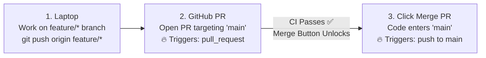

# 01 — GitHub Actions CI Pipeline & Branch Protection Guide (Part 1: Triggers & Frontend Job)

This document explains **what** every instruction in [`.github/workflows/ci.yml`](../../.github/workflows/ci.yml) does, **why** we configure Git & GitHub Branch Protection this way, and **what breaks** if any piece is removed or misconfigured.

---

## 1. The Big Picture: What Does a Standard DevOps CI Pipeline Do?

**Continuous Integration (CI)** has one primary goal:
> *"Verify that new code is working, clean, and safe **BEFORE** allowing it to merge into `main`."*

A complete, real-world DevOps CI pipeline for a containerized application focuses on **3 core stages**:
1. **Test Application Code (`npm test` / `npm run build`):** Verify the application logic and UI components work before packaging anything.
2. **Lint Dockerfiles (`hadolint`):** Check `Dockerfile` syntax and best practices before building.
3. **Build & Scan Container Images (`docker build` + `trivy`):** Verify the production container builds cleanly and has no critical security vulnerabilities (CVEs).

*(Note: Pushing images to AWS ECR and deploying to servers belongs to **CD (`deploy.yml`)**, which runs only after code is merged into `main`).*

---

## 2. Git Workflow, PR Targeting & Branch Protection



### Key Concepts for Quick Recall

* **`git push` vs. Pull Request (PR):**
  * Running `git push` from your laptop only uploads your local branch (e.g., `feature/day2-ci-pipeline`) to the exact same branch name on GitHub.
  * Whenever you want to **merge one branch into another branch** (e.g., `feature/day2-ci-pipeline` $\rightarrow$ `main`), you open a **Pull Request (PR)** on GitHub.
* **Who decides where a PR targets?**
  * **You (the human)** choose the target branch (`base: main` or `base: develop`) in the GitHub dropdown when creating the PR.
  * **`ci.yml`** does **not** create the PR—it acts as an **alarm sensor (listener)** that wakes up when it sees a PR targeting `main`.
* **Branching Strategies in Companies:**
  * **GitHub Flow (Single `main`):** `feature/*` $\rightarrow$ `main`. Used by fast-moving teams and our lab.
  * **GitFlow / Staging Flow ("Double Main"):** `feature/*` $\rightarrow$ `develop` (Testing Main) $\rightarrow$ `main` (Production Main). Used by larger enterprises.
* **Required Status Checks (Locking the Merge Button):**
  * Checking *"Require a pull request before merging"* alone still allows clicking Merge even if CI fails (red ❌).
  * You must also check **☑ Require status checks to pass before merging** (and add the job names like `frontend`) + **☑ Require branches to be up to date before merging** so GitHub physically locks the Merge button until all required CI jobs turn green ✅.

---

## 3. Current Minimal `.github/workflows/ci.yml` (Frontend Job)

```yaml
name: CI Pipeline

# Concept 1: The Trigger (When does this run?)
on:
  push:
    branches: ["main"]
  pull_request:
    branches: ["main"]

# Concept 2: First Job (Frontend)
jobs:
  frontend:
    runs-on: ubuntu-latest

    # Tell all commands in this job to run inside the ./frontend folder
    defaults:
      run:
        working-directory: ./frontend

    steps:
      # Step 1: Download the repo code into the empty ubuntu machine
      - name: Checkout repository
        uses: actions/checkout@v4

      # Step 2: Install Node.js 22 (and cache npm so future runs are fast)
      - name: Setup Node.js 22
        uses: actions/setup-node@v4
        with:
          node-version: 22
          cache: "npm"
          cache-dependency-path: frontend/package-lock.json

      # Step 3: Run commands inside ./frontend
      - name: Install dependencies
        run: npm ci

      - name: Run unit tests
        run: npm test

      - name: Build production bundle
        run: npm run build
```

---

## 4. Line-by-Line Breakdown

### `name: CI Pipeline`
* **What it does:** Sets the display title of the workflow in the GitHub **Actions** tab and PR check list.
* **What happens if removed:** GitHub falls back to showing the file path (`.github/workflows/ci.yml`).

---

### `on: pull_request: branches: ["main"]` vs. `push: branches: ["main"]`
* **`pull_request: branches: ["main"]` (Run #1 — Pre-Merge Gatekeeper):**
  * **What it does:** Runs whenever a PR targeting `main` is opened or updated with new commits.
  * **Why we use it:** Tests the feature branch **before** allowing it into `main`.
* **`push: branches: ["main"]` (Run #2 — Post-Merge Verification):**
  * **What it does:** Runs when someone clicks **"Merge Pull Request"** (which GitHub treats as a `push` commit onto `main`).
  * **Why we use it:** Catches collisions if two developers merged separate PRs around the same time, and gives the `main` branch its green status checkmark ✅.

---

### `jobs: frontend:` & `runs-on: ubuntu-latest`
* **What it does:** Declares a job named `frontend` and tells GitHub to spin up a fresh, isolated **Ubuntu Linux virtual machine** to run it.
* **Why we use it:** Each job under `jobs:` gets its own independent machine and runs in parallel with other jobs.

---

### `defaults: run: working-directory: ./frontend`
* **What it does:** Automatically runs all terminal commands (`run:`) inside the `./frontend` folder instead of the repository root.
* **Why we use it:** In a monorepo (`frontend/` + `backend/`), there is no `package.json` in the root folder.
* **Important Gotcha:** `defaults.run.working-directory` **only** applies to `run:` commands—it does **not** apply to `uses:` plugins (like `actions/setup-node@v4`), which always run from the repository root!

---

### Step 1 — `uses: actions/checkout@v4`
* **What it does:** Downloads (clones) your GitHub repository code into the empty Ubuntu runner.
* **What breaks if removed:** The Ubuntu machine is completely empty—`npm ci` will fail because your project files aren't on the machine yet.

---

### Step 2 — `uses: actions/setup-node@v4` (`cache-dependency-path`)
* **What it does:** Installs **Node.js 22** (matching our `node:22-alpine` Docker base image) and caches the `~/.npm` download folder based on `frontend/package-lock.json`.
* **What breaks if misconfigured:** Writing `cache-dependencies` instead of `cache-dependency-path` causes a yellow `Unexpected input(s)` warning and crashes with `Error: Dependencies lock file is not found` because `setup-node` looks in the repo root instead of `frontend/`.

---

### Step 3 — `npm ci`, `npm test`, and `npm run build`
* **`npm ci`:** Cleanly installs exact versions from `frontend/package-lock.json`.
* **`npm test`:** Runs React/API unit tests (`vitest run`). *(Wait: Why doesn't `docker build` test this? Because `.dockerignore` excludes `tests/` and `Dockerfile` uses `--omit=dev` to keep production images small!)*
* **`npm run build`:** Compiles the production Vite bundle (`dist/`) to verify there are no syntax or import errors.

---

## 5. Quick Reference: Conventional Commits & Reading Test Errors

### Conventional Commit Prefixes
| Prefix | Purpose | Example |
| :--- | :--- | :--- |
| `feat:` | New application feature | `feat: add ticket filter dropdown` |
| `fix:` | Bug fix in app or config | `fix(frontend): wrap fetch calls in try-catch` |
| `ci:` | GitHub Actions / CI pipeline changes | `ci: add initial frontend workflow` |
| `docs:` | Documentation updates | `docs: add CI pipeline reference guide` |
| `chore:` | Maintenance, moving files, lockfiles | `chore: reorganize docs folders` |

### The 3-Line Rule for Reading `npm test` Errors
When a test fails with a long stack trace, look only for these **3 lines**:
1. **WHERE:** `❯ src/api.test.js:20:5` (The exact file and line number).
2. **EXPECTED:** `- Unable to connect to the API server` (What the test wanted).
3. **RECEIVED:** `+ Failed to parse URL from /api/tickets/stats` (What actually happened).
