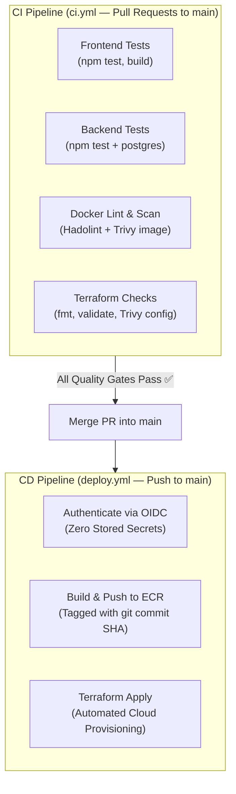

# 02 — CD Pipeline Architecture, OIDC, and 5-Day Practice Roadmap

This document outlines the Continuous Deployment (CD) design, the modern security model for cloud automation (OIDC), the strategy for multi-layer Trivy scanning, and the iterative roadmap for the next 5-day practice cycle.

---

## 1. CI vs. CD: Clear Separation of Concerns



* **`ci.yml` (The Quality Gate):** Runs on `pull_request: branches: ["main"]`. Validates code quality, runs unit tests, lints configurations, and scans for security vulnerabilities.
* **`deploy.yml` (The Executioner):** Runs on `push: branches: ["main"]` (and optionally `workflow_dispatch` for manual runs). Executes the deployment to cloud infrastructure once quality gates have passed.

---

## 2. Multi-Layer Security: Why Trivy Runs Twice in CI

Trivy is a multi-modal security scanner. Rather than running a single monolithic scan, production pipelines run **two distinct Trivy checks**:

| Scan Step | Command | Scan Target | What It Checks |
| :--- | :--- | :--- | :--- |
| **Container Scan** | `trivy image <image:tag>` | Built Docker image | Operating system CVEs (Alpine `apk`) and language dependencies (`package-lock.json`). |
| **IaC Misconfig Scan** | `trivy config ./terraform` | Terraform source files (`.tf`) | Cloud configuration risks (unencrypted S3 buckets, open security groups, wildcard IAM policies). |

### Benefit of Separation:
If a check fails in GitHub Actions, the pipeline clearly identifies the domain:
* A failure in `trivy image` directs attention to application packages or the base Docker image.
* A failure in `trivy config` directs attention to cloud infrastructure definitions in Terraform.

---

## 3. The CD Pipeline Template (`deploy.yml`)

When ready to activate automated deployments, the workflow is placed in `.github/workflows/deploy.yml`:

```yaml
name: CD Deploy Pipeline

on:
  push:
    branches: ["main"]
  workflow_dispatch: # Allows manual trigger from GitHub Actions UI

permissions:
  id-token: write  # Required for requesting the OIDC JWT token
  contents: read

jobs:
  deploy:
    name: Build, Push & Deploy
    runs-on: ubuntu-latest

    steps:
      - name: Checkout repository
        uses: actions/checkout@v4

      - name: Configure AWS Credentials (OIDC)
        uses: aws-actions/configure-aws-credentials@v4
        with:
          role-to-assume: ${{ secrets.AWS_ROLE_ARN }}
          aws-region: us-east-1

      - name: Log in to Amazon ECR
        id: login-ecr
        uses: aws-actions/amazon-ecr-login@v2

      - name: Build, Tag & Push Image to ECR
        env:
          REGISTRY: ${{ steps.login-ecr.outputs.registry }}
          REPOSITORY: opsticket-frontend
          IMAGE_TAG: ${{ github.sha }}
        run: |
          docker build -t $REGISTRY/$REPOSITORY:$IMAGE_TAG ./frontend
          docker push $REGISTRY/$REPOSITORY:$IMAGE_TAG

      - name: Deploy Infrastructure (Terraform)
        working-directory: ./terraform
        run: |
          terraform init
          terraform apply -auto-approve
```

---

## 4. Modern Authentication: GitHub OIDC vs. Static Secrets

### The Legacy Method (Static API Keys — Anti-Pattern)
* Generated a long-lived IAM User with `AWS_ACCESS_KEY_ID` and `AWS_SECRET_ACCESS_KEY`.
* Stored permanent credentials in GitHub Secrets.
* **Risks:** Credential leakage, rotation maintenance overhead, no automated expiration.

### The Modern Standard (OpenID Connect — OIDC)
* GitHub Actions dynamically requests a short-lived cryptographic JSON Web Token (JWT) from GitHub's OIDC provider.
* The runner sends the JWT to AWS Security Token Service (STS) using `sts:AssumeRoleWithWebIdentity`.
* AWS verifies the repository name, branch, and signature against an **IAM OpenID Connect Provider** and a Trust Policy.
* AWS grants a **temporary security token valid for 15 minutes** that automatically self-destructs.

---

## 5. Next Week's 5-Day Iteration Roadmap

When cycling back through the weekly schedule, pick up each day from the current baseline:

### Day 1: Containerization (Docker)
* **Current Baseline:** Working multi-stage Dockerfiles (`backend/Dockerfile`, `frontend/Dockerfile`, and `docker-compose.yml`).
* **Next Iteration:** Fine-tune image layer caching with BuildKit cache mounts (`--mount=type=cache`), verify signal handling and graceful shutdown (`tini` + `exec`), and re-run local Trivy scans with `--table-mode detailed`.

### Day 2: Continuous Integration (CI)
* **Current Baseline:** Minimal `frontend` job (`npm ci`, `npm test`, `npm run build`) in `.github/workflows/ci.yml`.
* **Next Iteration:**
  1. Add the **`backend` job** with a dedicated PostgreSQL service container to test Express API routes and Knex migrations.
  2. Add the **`docker` job** running Hadolint on both Dockerfiles, building container images, and running `trivy image`.
  3. Add the **`terraform` validation job** running `terraform fmt -check`, `terraform validate`, and `trivy config ./terraform`.

### Day 3: Infrastructure as Code (IaC)
* **Current Baseline:** S3 remote state with native locking (`use_lockfile = true`), ECR repository (`opsticket-frontend`), and IAM Role.
* **Next Iteration:** Define a reliable, low-cost compute target (such as a minimal EC2 instance with user-data Docker startup, or explore ECS Express Mode) to replace the sunset App Runner service.

### Day 4: Continuous Deployment (CD)
* **Current Baseline:** Documented CD architecture, OIDC design, and pipeline structure.
* **Next Iteration:** Provision the AWS OIDC Identity Provider and IAM Role in Terraform, configure `secrets.AWS_ROLE_ARN` in GitHub, and activate `.github/workflows/deploy.yml` to automatically push images to ECR on merge to `main`.

### Day 5: Monitoring, Alerting & Day 2 Operations
* **Focus:** Application health checks, log aggregation, CloudWatch alarms or Prometheus metrics, and automated disaster recovery scripts (like `scripts/backup-db.sh`).
