# 02 — CD Pipeline Architecture (`deploy.yml`), GitHub OIDC & Manual Approval Workflow

This document explains how our **Continuous Deployment (CD)** pipeline ([`.github/workflows/deploy.yml`](../../.github/workflows/deploy.yml)) and **AWS OIDC Identity Provider** ([`terraform-bootstrap/oidc.tf`](../../terraform-bootstrap/oidc.tf)) work together to automate cloud deployments (`plan`, `apply`, `destroy`) with zero static AWS keys and zero terminal commands.

---

## 1. CI vs. CD: Clear Separation of Responsibilities

```mermaid
flowchart TD
    subgraph CI ["1. CI Pipeline (ci.yml — Runs on Pull Requests)"]
        A1["Frontend Tests\n(npm test, build)"]
        A2["Backend Tests\n(npm test + Postgres 16)"]
        A3["Docker Lint & Scan\n(Hadolint + Trivy image)"]
        A4["Terraform Validation\n(fmt, validate, Trivy config)"]
    end

    subgraph CD ["2. CD Pipeline (deploy.yml — Runs on main & Manual Click)"]
        B1["Authenticate via OIDC\n(Zero Stored Passwords)"]
        B2["Auto-Run on Merge to main:\nterraform plan ONLY ($0.00)"]
        B3["Manual Dropdown Choice ('apply'):\nPhase 1: -target ECR\nPhase 2: Docker Build & Push\nPhase 3: Full terraform apply + URL Link"]
        B4["Manual Dropdown Choice ('destroy'):\nterraform destroy -auto-approve"]
    end

    CI -->|"All 4 Quality Gates Pass ✅"| Merge["Merge PR into main"]
    Merge --> B1
    B1 --> B2
    B1 --> B3
    B1 --> B4
```



* **`ci.yml` (The Quality Gatekeeper):** Runs on `pull_request` to `main`. Checks code, containers, and Terraform syntax without touching your live AWS account.
* **`deploy.yml` (The Cloud Operator):**
  * **On Merge to `main` (`push`):** Automatically logs into AWS and runs **`terraform plan` only** so you can review planned infrastructure changes safely at **$0.00 cost**.
  * **On Manual Click (`workflow_dispatch`):** Gives you a 3-option dropdown menu (**`plan`**, **`apply`**, **`destroy`**) in the GitHub Actions UI.

---

## 2. Passwordless Cloud Authentication: GitHub OIDC (`terraform-bootstrap/oidc.tf`)

### How Does GitHub Actions Log Into AWS Without `export AWS_PROFILE` or `aws sso login`?
On your laptop, a browser window pops up when you run `aws sso login`. Inside GitHub Actions (`ubuntu-latest`), there is no human at a browser.

Instead of storing permanent `AWS_ACCESS_KEY_ID` and `AWS_SECRET_ACCESS_KEY` passwords in GitHub Secrets, we use **OpenID Connect (OIDC)**:
1. GitHub Actions generates a temporary, cryptographically signed ID card (**JWT**) proving the job is running inside `Leospe24/opsticket-practice`.
2. `aws-actions/configure-aws-credentials@v4` sends that ID card to AWS STS (`sts:AssumeRoleWithWebIdentity`) along with `secrets.AWS_ROLE_ARN` (`arn:aws:iam::977308214565:role/opsticket-github-actions-role`).
3. Because the account number (`977308214565`) is built directly into the Role ARN, AWS verifies the ID card and hands the runner a **15-minute temporary login session** that self-destructs when the job finishes!

### Why Does `oidc.tf` Live Inside `terraform-bootstrap/` Instead of `terraform/`?
* **The Trap:** If we placed the GitHub OIDC Role inside `terraform/`, then clicking **`destroy`** (`terraform destroy`) in GitHub Actions would **delete GitHub's own login badge**! The next time you tried to run `deploy.yml`, GitHub wouldn't be able to log into AWS anymore.
* **The Solution:** Placing [`oidc.tf`](../../terraform-bootstrap/oidc.tf) inside `terraform-bootstrap/` (which is never destroyed and costs **$0.00 forever**) keeps GitHub's login badge permanently intact across unlimited `apply` and `destroy` cycles.

### [`terraform-bootstrap/oidc.tf`](../../terraform-bootstrap/oidc.tf)
```hcl
resource "aws_iam_openid_connect_provider" "github" {
  url            = "https://token.actions.githubusercontent.com"
  client_id_list = ["sts.amazonaws.com"]
  thumbprint_list = [
    "6938fd4d98bab03faadb97b34396831e3780aea1",
    "1c58a3a8518e8759bf075b76b750d4f2df264fcd",
  ]
}

resource "aws_iam_role" "github_actions" {
  name = "opsticket-github-actions-role"

  assume_role_policy = jsonencode({
    Version = "2012-10-17"
    Statement = [
      {
        Effect = "Allow"
        Principal = {
          Federated = aws_iam_openid_connect_provider.github.arn
        }
        Action = "sts:AssumeRoleWithWebIdentity"
        Condition = {
          StringEquals = {
            "token.actions.githubusercontent.com:aud" = "sts.amazonaws.com"
          }
          StringLike = {
            "token.actions.githubusercontent.com:sub" = "repo:Leospe24*/opsticket-practice*:*"
          }
        }
      }
    ]
  })
}

# Grant permissions so GitHub Actions can run Terraform (VPC, EC2, ECR, IAM, S3 State)
resource "aws_iam_role_policy_attachment" "github_actions_admin" {
  role       = aws_iam_role.github_actions.name
  policy_arn = "arn:aws:iam::aws:policy/AdministratorAccess"
}

output "github_actions_role_arn" {
  value = aws_iam_role.github_actions.arn
}
```

### 3 Critical OIDC Concepts to Remember:
1. **Does `aws_iam_openid_connect_provider` belong to GitHub or the AWS Account? (`resource` vs. `data`)**
   * It lives **100% inside the AWS Account** (only **1** `token.actions.githubusercontent.com` provider is allowed per AWS account).
   * **1st project in a new AWS account:** Always use **`resource "aws_iam_openid_connect_provider"`** to create it in that AWS account.
   * **2nd/3rd project in the SAME AWS account:** Use **`data "aws_iam_openid_connect_provider"`** (`url = "https://token.actions.githubusercontent.com"`) to look up and reuse the existing provider!
2. **Why `"repo:Leospe24*/opsticket-practice*:*"` Uses Wildcards `*`:**
   * For newly created repositories, GitHub embeds immutable numeric IDs (`@<user_id>` and `@<repo_id>`) into the OIDC `sub` claim: `repo:Leospe24@123456/opsticket-practice@789012:ref:refs/heads/main`.
   * Placing `*` after `Leospe24` (`Leospe24*`) and after `opsticket-practice` (`opsticket-practice*`) allows `StringLike` to match the `@numeric_id` automatically without hardcoding long ID numbers!
3. **What if you destroy and re-apply `terraform-bootstrap`?**
   * Because the Role ARN (`arn:aws:iam::977308214565:role/opsticket-github-actions-role`) is built from your fixed Account ID and fixed Role `name`, re-creating it generates the **exact same ARN string**—so you don't even have to update `AWS_ROLE_ARN` in GitHub Secrets!

---

## 3. Complete `.github/workflows/deploy.yml` Breakdown

```yaml
name: CD Deploy Pipeline

on:
  push:
    branches: ["main"]
  workflow_dispatch:
    inputs:
      action:
        description: "Choose Terraform Action to Run"
        required: true
        default: "plan"
        type: choice
        options:
          - plan
          - apply
          - destroy

permissions:
  id-token: write
  contents: read

jobs:
  deploy:
    runs-on: ubuntu-latest

    steps:
      - name: Checkout repository
        uses: actions/checkout@v4

      - name: Configure AWS Credentials via OIDC
        uses: aws-actions/configure-aws-credentials@v4
        with:
          role-to-assume: ${{ secrets.AWS_ROLE_ARN }}
          aws-region: us-east-1

      - name: Setup Terraform
        uses: hashicorp/setup-terraform@v3
        with:
          terraform_wrapper: false

      # Initialize Terraform
      - name: Terraform Init
        working-directory: ./terraform
        run: terraform init

      # CHOICE 1: Runs automatically on push to main OR when you select "plan"
      - name: Terraform Plan
        if: github.event_name == 'push' || inputs.action == 'plan'
        working-directory: ./terraform
        run: terraform plan

      # CHOICE 2: Runs when you select "apply"
      - name: Phase 1 - Create Empty ECR Repositories
        if: inputs.action == 'apply'
        working-directory: ./terraform
        run: terraform apply -target=aws_ecr_repository.backend -target=aws_ecr_repository.frontend -auto-approve

      - name: Phase 2 - Login to ECR
        if: inputs.action == 'apply'
        id: login-ecr
        uses: aws-actions/amazon-ecr-login@v2

      - name: Phase 2 - Build and Push Docker Images to ECR
        if: inputs.action == 'apply'
        env:
          REGISTRY: ${{ steps.login-ecr.outputs.registry }}
        run: |
          docker build -t $REGISTRY/opsticket-backend:v1 ./backend
          docker push $REGISTRY/opsticket-backend:v1

          docker build -t $REGISTRY/opsticket-frontend:v1 ./frontend
          docker push $REGISTRY/opsticket-frontend:v1

      - name: Phase 3 - Terraform Apply Full Infrastructure
        if: inputs.action == 'apply'
        working-directory: ./terraform
        run: |
          terraform apply -auto-approve
          echo "### 🚀 OpsTicket Live Deployment" >> $GITHUB_STEP_SUMMARY
          echo "🌐 **Live Website URL:** $(terraform output -raw website_url)" >> $GITHUB_STEP_SUMMARY

      # CHOICE 3: Runs when you select "destroy"
      - name: Terraform Destroy Infrastructure
        if: inputs.action == 'destroy'
        working-directory: ./terraform
        run: terraform destroy -auto-approve
```

### Key Workflow Details:
* **Why you only click `apply` ONCE:** All 4 steps under `CHOICE 2` share `if: inputs.action == 'apply'`, so a single click executes Phase 1 (`-target` ECR) $\rightarrow$ Phase 2 (`docker build & push`) $\rightarrow$ Phase 3 (`terraform apply`) sequentially in one run.
* **What happens if you click `apply` a 2nd time without destroying first? (Idempotency):**
  * In Phase 1, Terraform checks `terraform.tfstate` in S3, sees both ECR repositories already exist, says `0 added, 0 changed, 0 destroyed` in 2 seconds, and moves straight to Phase 2 without wiping your ECR repos!
* **`terraform_wrapper: false` + `$GITHUB_STEP_SUMMARY`:**
  * Setting `terraform_wrapper: false` on `setup-terraform@v3` ensures `$(terraform output -raw website_url)` returns a clean URL string.
  * Writing to `$GITHUB_STEP_SUMMARY` renders a clickable **🌐 Live Website URL** card directly on the GitHub Actions run summary page!
