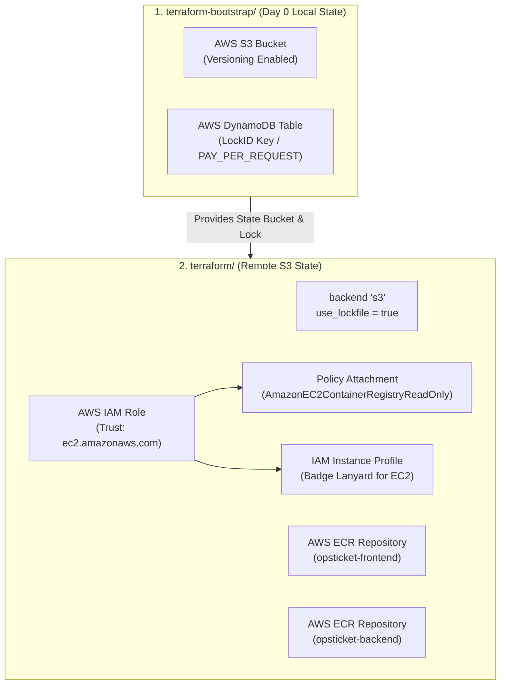
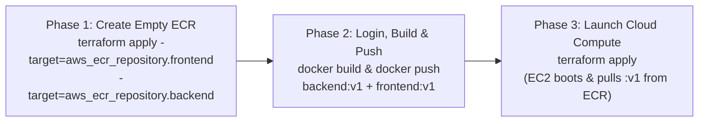

# 01 — Terraform Bootstrap, Remote State, ECR & IAM Guide

This document explains **what** each component of our foundational Infrastructure as Code (IaC) setup does, **why** it is designed this way in production, **how** the 3-Phase Cloud Container Sequence works, and **what would break** if any piece were removed or misconfigured.

---

## 1. High-Level Architecture: State Storage, Container Registry & IAM Badge



---

## 2. Why a Separate `terraform-bootstrap/` Folder? (The Chicken & Egg Problem)

* **The Problem:** When configuring Terraform to store its state file remotely in an AWS S3 bucket (`backend "s3"`), Terraform must connect to that bucket during `terraform init`—*before* any resource can be created. You cannot use Terraform to create the very S3 bucket it needs to store its own state.
* **The Solution:** We create a lightweight, one-time "Day 0" bootstrap directory ([`terraform-bootstrap/main.tf`](../../terraform-bootstrap/main.tf)):
  1. It runs using standard **local state** on your laptop.
  2. Its sole purpose is to provision the **S3 Bucket** (with Versioning) and the **DynamoDB Table** (for classic state locking).
  3. Once provisioned, you never touch `terraform-bootstrap/` again—all ongoing infrastructure work happens in [`terraform/`](../../terraform), which points its `backend "s3"` block to that bucket.

---

## 3. Terraform Versioning & Provider Constraints (`provider.tf`)

```hcl
terraform {
  required_version = ">= 1.16.0"

  # S3 backend terraform state
  backend "s3" {
    bucket       = "opsticket-tf-state-patrick-lab"
    key          = "opsticket/terraform.tfstate"
    region       = "us-east-1"
    use_lockfile = true
    encrypt      = true
  }

  required_providers {
    aws = {
      source  = "hashicorp/aws"
      version = "~> 6.0"
    }
  }
}

provider "aws" {
  region = "us-east-1"
}
```

### Key Concepts:
* **`required_version = ">= 1.16.0"`:** Enforces that the Terraform CLI binary is at least `1.16.0`.
* **`version = "~> 6.0"` (Pessimistic Constraint):** Allows safe minor updates (`6.1`, `6.70`) while blocking major breaking versions (`7.0`).
* **`use_lockfile = true` vs. `dynamodb_table`:**
  * **Classic Method:** Used `dynamodb_table = "opsticket-tf-locks"` with primary key `LockID` because S3 lacked native write locking.
  * **Modern Method (Terraform 1.10+ / 1.16+):** `use_lockfile = true` uses native S3 Conditional Writes (`If-None-Match`) to write a `.tflock` file directly inside the S3 bucket, preventing two engineers or pipelines from running `terraform apply` at the exact same time.
* **`encrypt = true`:** Encrypts `terraform.tfstate` at rest in S3.

---

## 4. Amazon ECR (Elastic Container Registry) & The 3-Phase Cloud Sequence

### Why Do Cloud Servers Pull from ECR Instead of Building Code Directly?
1. **No `git clone` or `docker build` on Production Servers:** Running `npm ci` and `docker build` directly on a small production server (`t3.micro` with 1GB RAM) exhausts memory and exposes raw source code on the server.
2. **Central Warehouse ("Build Once, Run Anywhere"):** We build and scan the images once (on our laptop or in GitHub Actions) and push the finished images into **AWS ECR** (our private AWS "Docker Hub"). Any AWS compute service (**EC2**, **ECS**, or **EKS/Kubernetes**) can then pull and run those pre-built images in seconds.

### [`terraform/ecr.tf`](../../terraform/ecr.tf)
```hcl
resource "aws_ecr_repository" "frontend" {
  name         = "opsticket-frontend"
  force_delete = true
}

resource "aws_ecr_repository" "backend" {
  name         = "opsticket-backend"
  force_delete = true
}
```

* **Why only 2 ECR Repositories (`frontend` and `backend`) instead of 3?**
  * `frontend` and `backend` are custom images built from our own `Dockerfile`s, so they need private ECR repositories.
  * Our 3rd tier (`database`) uses the official `postgres:16-alpine` image, which Docker pulls directly from public Docker Hub!
* **Why `force_delete = true`? (ECR vs. S3 Naming):**
  * Terraform creates the **empty ECR folder**, while `docker push` puts container images (`:v1`) inside it.
  * By default (`force_delete = false`), if an ECR repository contains even 1 image, AWS blocks `terraform destroy` with `RepositoryNotEmptyException`.
  * Setting `force_delete = true` (called `force_destroy = true` on S3 buckets) allows `terraform destroy` to automatically wipe out the images and delete the repository during lab teardown.

### The 3-Phase Cloud Container Sequence (Solving the Empty Registry Problem)
If you run a full `terraform apply` from zero before pushing images, Terraform creates **empty** ECR repositories and boots the EC2 server at the same time—causing the EC2 server to fail when trying to pull `:v1` from an empty registry.

In both local testing and automated CD (`deploy.yml`), we follow this **3-Phase Sequence**:



```bash
# Phase 1: Create the 2 empty ECR warehouses first
cd terraform
terraform apply -target=aws_ecr_repository.frontend -target=aws_ecr_repository.backend -auto-approve
cd ..

# Phase 2: Authenticate Docker & Push both :v1 images into ECR
aws ecr get-login-password --region us-east-1 | docker login --username AWS --password-stdin <account_id>.dkr.ecr.us-east-1.amazonaws.com

docker build -t <account_id>.dkr.ecr.us-east-1.amazonaws.com/opsticket-backend:v1 ./backend
docker push <account_id>.dkr.ecr.us-east-1.amazonaws.com/opsticket-backend:v1

docker build -t <account_id>.dkr.ecr.us-east-1.amazonaws.com/opsticket-frontend:v1 ./frontend
docker push <account_id>.dkr.ecr.us-east-1.amazonaws.com/opsticket-frontend:v1

# Phase 3: Provision VPC, Firewall, IAM & EC2 Server
cd terraform
terraform apply -auto-approve
```

---

## 5. IAM Role, Read-Only Policy & Instance Profile Badge ([`terraform/iam.tf`](../../terraform/iam.tf))

Instead of storing personal AWS access keys on the EC2 server (a major security risk), we attach a **3-Piece IAM Security Badge** to the EC2 instance:

```hcl
# 1. IAM Role (Trust Policy): WHO is allowed to wear this badge? (EC2)
resource "aws_iam_role" "ec2_ecr_role" {
  name = "opsticket-ec2-ecr-role"

  assume_role_policy = jsonencode({
    Version = "2012-10-17"
    Statement = [
      {
        Effect = "Allow"
        Principal = {
          Service = "ec2.amazonaws.com"
        }
        Action = "sts:AssumeRole"
      }
    ]
  })
}

# 2. Policy Attachment (Permissions): WHAT doors does this badge unlock? (ECR Read-Only)
resource "aws_iam_role_policy_attachment" "ec2_ecr_policy" {
  role       = aws_iam_role.ec2_ecr_role.name
  policy_arn = "arn:aws:iam::aws:policy/AmazonEC2ContainerRegistryReadOnly"
}

# 3. Instance Profile: The "Badge Lanyard" that clips the Role onto an EC2 server
resource "aws_iam_instance_profile" "ec2_ecr_profile" {
  name = "opsticket-ec2-ecr-profile"
  role = aws_iam_role.ec2_ecr_role.name
}
```

### Why 3 Pieces? (Interview Quick Recall)
1. **`aws_iam_role` (`Service = "ec2.amazonaws.com"`):** Defines the **Trust Policy**—only AWS EC2 virtual machines are trusted to assume this role.
2. **`aws_iam_role_policy_attachment` (`AmazonEC2ContainerRegistryReadOnly`):** Follows **Least Privilege**. The EC2 server can download (`docker pull`) images from ECR, but cannot delete or overwrite repositories.
3. **`aws_iam_instance_profile`:** Unlike newer serverless services, an EC2 virtual machine cannot attach an IAM Role directly—it requires an **Instance Profile ("badge holder/lanyard")** that wraps the IAM Role and plugs into `aws_instance.web.iam_instance_profile`.

---

## 6. When Are Terraform `output` Blocks Actually Needed?

* **Not needed for file-to-file references in the same folder:** `ec2.tf` can directly read `aws_iam_instance_profile.ec2_ecr_profile.name` (from `iam.tf`) and `aws_subnet.public.id` (from `vpc.tf`) without any `output` blocks!
* **Only write `output` when a human or external script needs the value:**
  * `website_url` in `ec2.tf` (so you can click `http://<public-ip>` right after `terraform apply`).
  * `s3_bucket_name` in `terraform-bootstrap/` (to copy into `terraform/provider.tf`).
  * `github_oidc_role_arn` on Day 4 CD (to paste into GitHub Actions Secrets).
