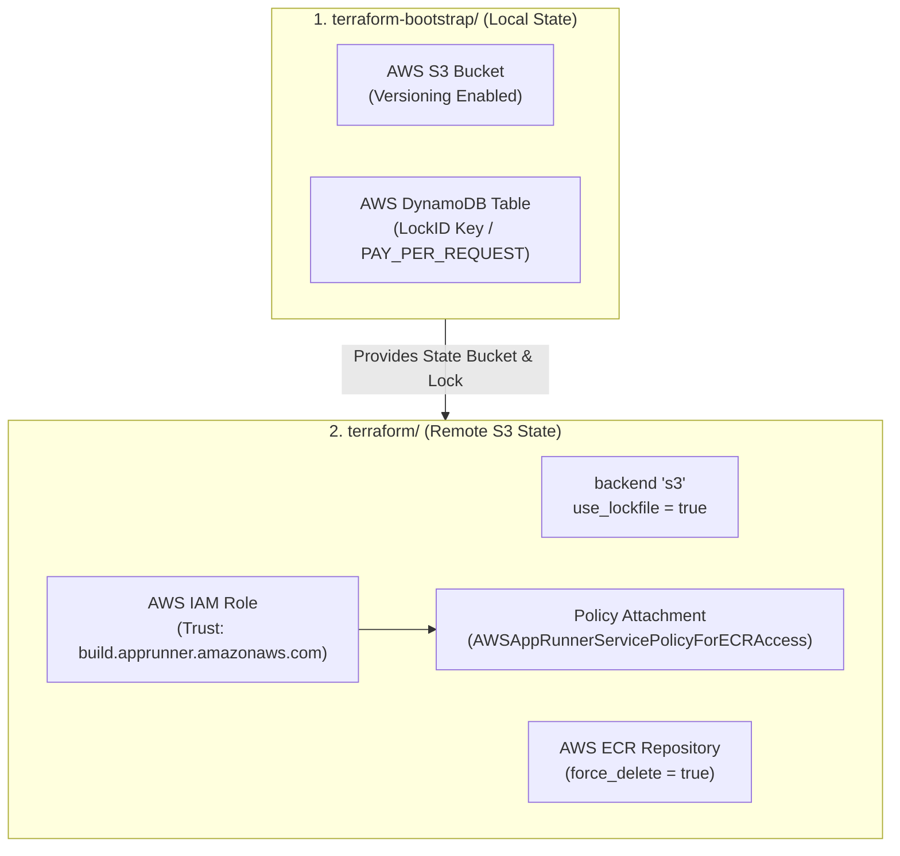

# 01 — Terraform Bootstrap, Remote State, ECR & IAM Guide

This document explains **what** each component of the Infrastructure as Code (IaC) setup does, **why** it is designed this way for production, and **what would break** if it were removed or misconfigured.

---

## 1. High-Level Architecture: State Storage & Container Registry



---

## 2. Why a Separate `terraform-bootstrap/` Folder? (The Chicken & Egg Problem)

* **The Problem:** When configuring Terraform to store its state file remotely in an AWS S3 bucket (`backend "s3"`), Terraform must connect to that bucket during `terraform init`—*before* any resource can be created. You cannot use Terraform to create the very S3 bucket it needs to store its own state.
* **The Solution:** We create a lightweight, one-time bootstrap directory (`terraform-bootstrap/`).
  1. It runs using standard **local state** on your machine.
  2. Its sole purpose is to provision the **S3 Bucket** (with Versioning) and the **DynamoDB Table** (for state locking).
  3. Once provisioned, our main infrastructure directory (`terraform/`) configures its `backend "s3"` block to point to these resources.

---

## 3. Terraform Versioning & Provider Constraints

```hcl
terraform {
  required_version = ">= 1.16.0"

  required_providers {
    aws = {
      source  = "hashicorp/aws"
      version = "~> 6.0"
    }
  }
}
```

### `required_version = ">= 1.16.0"`
* **What it does:** Enforces that the Terraform CLI binary installed on the operator's machine or CI/CD runner is at least version `1.16.0`.
* **Semantic Versioning Concept (`Major.Minor.Patch`):** In software versioning, the dot is not a decimal. `1.16.1` represents Major version 1, Minor update 16, Patch 1—meaning it is 11 releases newer than `1.5.0` (`1.5` $\rightarrow$ `1.9` $\rightarrow$ `1.10` $\rightarrow$ `1.16`). Using `>= 1.16.0` ensures team members do not run outdated CLI engines lacking modern features.

### `required_providers { aws = { version = "~> 6.0" } }`
* **What it does:** Downloads the official AWS provider plugin from the HashiCorp registry and pins it using the pessimistic constraint operator (`~>`).
* **Why we pin `~> 6.0`:** The `~>` operator allows backwards-compatible minor releases (`6.1`, `6.70`), but blocks major breaking version increments (`7.0.0`). For instance, when HashiCorp released AWS Provider `v4.0`, S3 bucket sub-resources (like versioning and website hosting) were split from `aws_s3_bucket` into standalone resources, which broke older codebases. Pinning major versions prevents unexpected CI failures.

---

## 4. Remote State Storage & The Locking Evolution

### Classic Method vs. Modern Native S3 Locking

| Parameter | Mechanism | Supported Versions | Notes |
| :--- | :--- | :--- | :--- |
| `dynamodb_table = "opsticket-tf-locks"` | External lock coordination via DynamoDB primary key `LockID`. | All Terraform versions | Historically required because S3 lacked native write locks. |
| `use_lockfile = true` | Native S3 locking using S3 Conditional Writes (`If-None-Match`). | Terraform 1.10+ / 1.16+ | **Recommended**. Automatically writes `.tflock` inside S3. Deprecates `dynamodb_table`. |

### The `terraform/providers.tf` Backend Configuration
```hcl
terraform {
  required_version = ">= 1.16.0"

  backend "s3" {
    bucket       = "opsticket-tf-state-patrick-lab"
    key          = "opsticket/terraform.tfstate"
    region       = "us-east-1"
    encrypt      = true
    use_lockfile = true
  }

  required_providers {
    aws = {
      source  = "hashicorp/aws"
      version = "~> 6.0"
    }
  }
}

provider "aws" {
  region = "us-east-1"
}
```

* **`bucket`:** Name of the S3 bucket created by the bootstrap step.
* **`key`:** The file path inside the bucket where state is persisted.
* **`encrypt = true`:** Enforces server-side encryption (AES-256) at rest, protecting sensitive data (passwords, tokens) recorded in the state file.
* **`use_lockfile = true`:** Prevents concurrent `terraform apply` operations from corrupting the state file without needing a separate DynamoDB table.

---

## 5. Amazon ECR (Elastic Container Registry)

```hcl
resource "aws_ecr_repository" "frontend" {
  name         = "opsticket-frontend"
  force_delete = true
}

output "ecr_repository_url" {
  value = aws_ecr_repository.frontend.repository_url
}
```

### Line-by-Line Breakdown:
* **`name = "opsticket-frontend"`:** Names the private Docker repository in your AWS account.
* **`force_delete = true` (ECR vs. S3 Naming):**
  * On S3 buckets (`aws_s3_bucket`), the attribute to delete non-empty buckets is `force_destroy = true`.
  * On ECR repositories (`aws_ecr_repository`), the attribute is **`force_delete = true`**.
  * **Why it matters:** By default, AWS blocks deletion of any ECR repository containing container images (`RepositoryNotEmptyException`). Setting `force_delete = true` ensures `terraform destroy` cleanly removes the repository and all tagged images during teardown.
* **`output "ecr_repository_url"`:** Exports the full registry endpoint URI (`<account_id>.dkr.ecr.<region>.amazonaws.com/<repo_name>`) for pipeline automation.

---

## 6. Docker Authentication and Push Workflow

Docker CLI requires temporary credentials generated via the AWS CLI to push to private ECR registries.

### Step 1: ECR Login
```bash
aws ecr get-login-password --region us-east-1 | docker login --username AWS --password-stdin <account_id>.dkr.ecr.us-east-1.amazonaws.com
```
* Generates an authorization token via AWS STS/ECR that is valid for 12 hours.
* Pipes the temporary password into `docker login`.

### Step 2: Tagging Local Image
```bash
docker tag opsticket-frontend:latest <account_id>.dkr.ecr.us-east-1.amazonaws.com/opsticket-frontend:v1
```
* Links the locally built image to the full remote ECR destination.
* Pins explicit version tags (`:v1`) instead of floating `:latest` tags.

### Step 3: Pushing to AWS
```bash
docker push <account_id>.dkr.ecr.us-east-1.amazonaws.com/opsticket-frontend:v1
```
* Uploads compressed image layers into AWS ECR.

---

## 7. IAM Role & Permissions Architecture

In AWS, services have zero permissions by default. When an AWS compute service needs to pull images from ECR, it requires an IAM Role composed of two elements:

```hcl
# 1. Trust Policy: WHO can assume this role?
resource "aws_iam_role" "apprunner_ecr_role" {
  name = "opsticket-apprunner-ecr-role"

  assume_role_policy = jsonencode({
    Version = "2012-10-17"
    Statement = [
      {
        Effect = "Allow"
        Principal = {
          Service = "build.apprunner.amazonaws.com"
        }
        Action = "sts:AssumeRole"
      }
    ]
  })
}

# 2. Permissions Policy: WHAT can the role do?
resource "aws_iam_role_policy_attachment" "apprunner_ecr_policy" {
  role       = aws_iam_role.apprunner_ecr_role.name
  policy_arn = "arn:aws:iam::aws:policy/service-role/AWSAppRunnerServicePolicyForECRAccess"
}
```

* **`assume_role_policy` (Trust Policy):** Grants the target AWS service principal permission to assume the role via AWS STS (`sts:AssumeRole`).
* **`jsonencode()`:** Converts HCL syntax into standard AWS IAM JSON formatting.
* **`Version = "2012-10-17"`:** Fixed identifier for the AWS IAM policy syntax revision (not a variable date).
* **`aws_iam_role_policy_attachment`:** Attaches the AWS-managed policy `AWSAppRunnerServicePolicyForECRAccess` to grant `ecr:GetDownloadUrlForLayer`, `ecr:BatchGetImage`, and `ecr:GetAuthorizationToken`.
