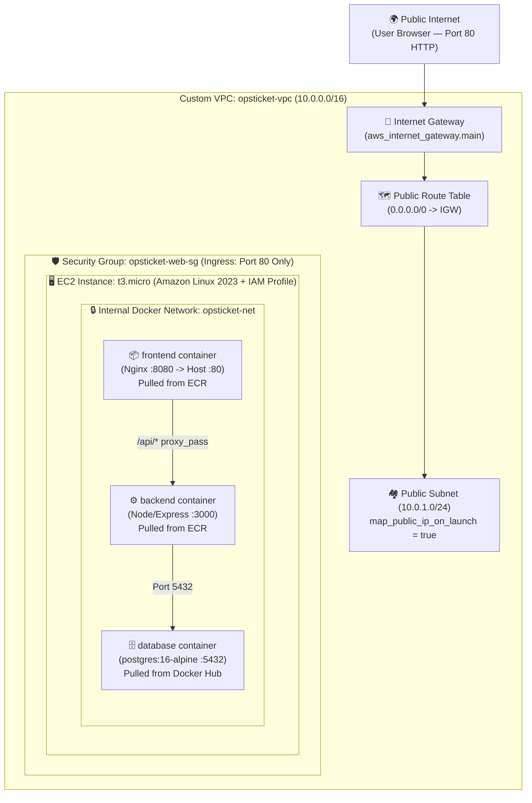

# 02 — Custom VPC, Cloud Firewall (Security Group) & 3-Tier EC2 Container Host

This document explains how our networking ([`terraform/vpc.tf`](../../terraform/vpc.tf)), cloud firewall ([`terraform/security.tf`](../../terraform/security.tf)), and 3-tier EC2 container host ([`terraform/ec2.tf`](../../terraform/ec2.tf)) work together, why we architected them this way for cost and security, and how to explain the trade-offs in interviews.

---

## 1. Full Architecture Diagram: 3-Tier Stack Inside Custom VPC



---

## 2. Custom VPC Networking ([`terraform/vpc.tf`](../../terraform/vpc.tf))

Instead of relying on the account's built-in Default VPC, we provision a dedicated, self-contained **Custom VPC** (100% free in AWS and cleanly removed on `terraform destroy`).

### The 5 Building Blocks of [`terraform/vpc.tf`](../../terraform/vpc.tf):

```hcl
# 1. The Fenced Land (VPC)
resource "aws_vpc" "main" {
  cidr_block           = "10.0.0.0/16"
  enable_dns_hostnames = true
  enable_dns_support   = true

  tags = {
    Name = "opsticket-vpc"
  }
}

# 2. The Street Where EC2 Lives (Public Subnet)
resource "aws_subnet" "public" {
  vpc_id                  = aws_vpc.main.id
  cidr_block              = "10.0.1.0/24"
  availability_zone       = "us-east-1a"
  map_public_ip_on_launch = true

  tags = {
    Name = "opsticket-public-subnet"
  }
}

# 3. The Main Gate to the Internet (Internet Gateway)
resource "aws_internet_gateway" "main" {
  vpc_id = aws_vpc.main.id

  tags = {
    Name = "opsticket-igw"
  }
}

# 4. The GPS Road Sign (Route Table pointing 0.0.0.0/0 to the Gate)
resource "aws_route_table" "public" {
  vpc_id = aws_vpc.main.id

  route {
    cidr_block = "0.0.0.0/0"
    gateway_id = aws_internet_gateway.main.id
  }

  tags = {
    Name = "opsticket-public-rt"
  }
}

# 5. Link the Route Table to the Public Subnet
resource "aws_route_table_association" "public" {
  subnet_id      = aws_subnet.public.id
  route_table_id = aws_route_table.public.id
}
```

### Lab Public Subnet vs. Strict 3-Tier Enterprise Architecture (Interview Gold!)

| Tier | Our Cost-Optimized DevOps Lab ($0 Network Cost) | Strict Enterprise Production (~$70+/month Network & DB Cost) |
| :--- | :--- | :--- |
| **Entry Point** | EC2 Public IP (`Port 80`) in **Public Subnet** via free **Internet Gateway ($0)** | **Application Load Balancer (ALB)** in Public Subnets |
| **App Compute** | `frontend` & `backend` Docker containers on EC2 (`opsticket-net`) | **ECS Fargate Tasks** in **Private App Subnets** (using paid **NAT Gateway** or **VPC Endpoints** to reach ECR) |
| **Database** | `postgres:16-alpine` Docker container on `opsticket-net` (hidden from internet) | **Amazon RDS (`aws_db_instance`)** for SQL or **DynamoDB / DocumentDB** for NoSQL in **Private Data Subnets** |

> **Why companies never run a production database inside an ECS Task:** ECS tasks are stateless and disposable—restarting or redeploying a task wipes its container filesystem. Production clouds use managed **Amazon RDS** (for PostgreSQL/MySQL) or **DynamoDB / MongoDB Atlas** (for NoSQL) for persistent storage and automated backups.

---

## 3. Cloud Firewall & Trivy Surgical Ignores ([`terraform/security.tf`](../../terraform/security.tf))

By default, AWS Security Groups block **100% of incoming traffic**. We explicitly open only **Port `80` (HTTP)** for incoming browser traffic (`ingress`) and allow outbound internet traffic (`egress`) so the EC2 server can install Docker and pull images from ECR.

```hcl
resource "aws_security_group" "web" {
  name        = "opsticket-web-sg"
  description = "Allow HTTP inbound traffic on port 80 and all outboud traffic"
  vpc_id      = aws_vpc.main.id

  ingress {
    description = "Allow HTTP from anywhere"
    from_port   = 80
    to_port     = 80
    protocol    = "tcp"
    cidr_blocks = ["0.0.0.0/0"]
  }

  # trivy:ignore:AVD-AWS-0104
  egress {
    description = "Allow all outbound internet access"
    from_port   = 0
    to_port     = 0
    protocol    = "-1"
    cidr_blocks = ["0.0.0.0/0"]
  }

  tags = {
    Name = "opsticket-web-sg"
  }
}
```

### Key Security Concepts:
1. **Why Port `22` (SSH) is NOT open:**
   * Opening Port `22` to `0.0.0.0/0` exposes the server to brute-force bots and triggers Trivy **`AWS-0107 (CRITICAL)`**.
   * Because our EC2 server configures itself automatically via **`user_data`**, Port `22` stays completely closed! *(If terminal access is ever needed in production, teams use **AWS Systems Manager Session Manager (SSM)** via IAM without opening Port 22).*
2. **Why `ingress` on Port `80` (`0.0.0.0/0`) passes Trivy, while `egress` (`0.0.0.0/0`) flags `AWS-0104`:**
   * Trivy expects a public web server to accept inbound traffic on Port `80`.
   * However, Trivy flags any `egress` rule containing `cidr_blocks = ["0.0.0.0/0"]` (`AWS-0104`) because strict enterprise networks use paid PrivateLink VPC Endpoints (`10.0.0.0/16`) instead of the public Internet Gateway.
   * Since AWS ECR and Linux package mirrors use dynamically changing public IPs over our free Internet Gateway, outbound `0.0.0.0/0` is required.
3. **Why `# trivy:ignore:AVD-AWS-0104` (Inline) vs. `.trivyignore` (Global):**
   * **`.trivyignore` (Global):** Used for package CVEs inside built Docker images (like `CVE-2026-59873` in `tar`), where you cannot write a `# comment` inside `node_modules`.
   * **`# trivy:ignore:AVD-AWS-0104` (Surgical Line Comment):** Used in Terraform `.tf` files so the exception **only** applies to this specific `web` Security Group. If you later create a private database Security Group (`db_sg`) and accidentally open its `egress` to `0.0.0.0/0`, Trivy will still catch it!

---

## 4. EC2 Container Host & 3-Tier `user_data` Bootstrap ([`terraform/ec2.tf`](../../terraform/ec2.tf))

### Why We Don't Use `docker-compose.yml` in CI/CD or Cloud IaC
* **`docker-compose.yml` is for your local laptop:** It lets developers spin up `frontend`, `backend`, and `database` locally with one command (`docker compose up`).
* **In CI/CD and Cloud (`ec2.tf` / ECS / Kubernetes):** Your individual **`Dockerfile`s** are built into images and pushed to **ECR**. On our Amazon Linux 2023 EC2 host, `user_data` replicates what Compose does under the hood using built-in Docker commands: creating a private bridge network (`docker network create opsticket-net`) and starting all 3 containers so they communicate by container `--name` (`database`, `backend`, `frontend`).

```hcl
data "aws_ami" "amazon_linux_2023" {
  most_recent = true
  owners      = ["amazon"]

  filter {
    name   = "name"
    values = ["al2023-ami-2023.*-x86_64"]
  }
}

resource "aws_instance" "web" {
  ami                    = data.aws_ami.amazon_linux_2023.id
  instance_type          = "t3.micro"
  subnet_id              = aws_subnet.public.id
  vpc_security_group_ids = [aws_security_group.web.id]
  iam_instance_profile   = aws_iam_instance_profile.ec2_ecr_profile.name

  # Startup script
  user_data = <<-EOF
              #!/usr/bin/env bash
              dnf update -y
              dnf install -y docker
              systemctl enable --now docker

              # Create private internal Docker network
              docker network create opsticket-net

              # Log in to private ECR using EC2 IAM Role badge
              aws ecr get-login-password --region us-east-1 | docker login --username AWS --password-stdin ${aws_ecr_repository.frontend.repository_url}

              # 1. Start Database container (PostgreSQL)
              docker run -d --name database --network opsticket-net --restart unless-stopped \
                  -e POSTGRES_USER=opsticket \
                  -e POSTGRES_PASSWORD=opsticket \
                  -e POSTGRES_DB=opsticket \
                  postgres:16-alpine

              # Wait 10 seconds for the database to initialize
              sleep 10

              # 2. Start Backend container (Runs migrations automatically on startup)
              docker run -d --name backend --network opsticket-net --restart unless-stopped \
                  -e PORT=3000 \
                  -e DB_HOST=database \
                  -e DB_PORT=5432 \
                  -e DB_USER=opsticket \
                  -e DB_PASSWORD=opsticket \
                  -e DB_NAME=opsticket \
                  -e JWT_SECRET=production-lab-jwt-secret-key \
                  -e FRONTEND_URL=http://localhost \
                  ${aws_ecr_repository.backend.repository_url}:v1

              # 3. Start Frontend container (Nginx on port 80 -> proxies /api/ to backend:3000)
              docker run -d --name frontend --network opsticket-net --restart unless-stopped \
                  -p 80:8080 \
                  ${aws_ecr_repository.frontend.repository_url}:v1
              EOF

  tags = {
    Name = "opsticket-web-server"
  }
}

output "website_url" {
  value = "http://${aws_instance.web.public_ip}"
}
```

### Line-by-Line Highlights:
* **`data "aws_ami"` vs. `resource`:** A `resource` block **creates** a new cloud object; a `data` block **queries** an existing one. Querying `al2023-ami-2023.*-x86_64` with `most_recent = true` ensures our code never breaks when AWS retires older Linux AMIs.
* **`docker network create opsticket-net`:** Creates an isolated internal network on the EC2 host. Only `frontend` maps `-p 80:8080` to the host; `backend` (`3000`) and `database` (`5432`) have **no host ports exposed** and can only be reached inside `opsticket-net`.
* **`sleep 10` before `backend`:** Gives PostgreSQL time to initialize the `opsticket` database before the `backend` container boots and runs `npm run migrate` (`knex migrate:latest`).
